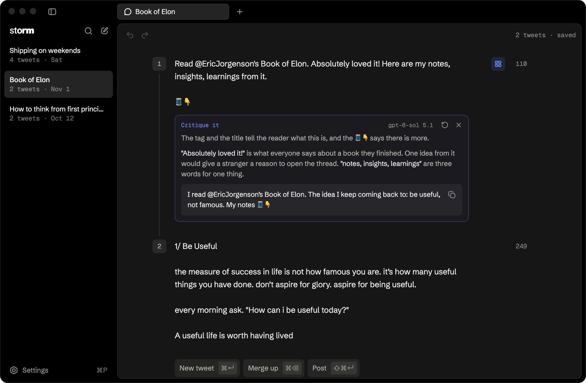

<p align="center">
  <picture>
    <source media="(prefers-color-scheme: dark)" srcset="assets/logo-dark.png" />
    
  </picture>
</p>

<p align="center">A place for your X threads.</p>

<p align="center"><a href="https://vgnshiyer.me/storm/">vgnshiyer.me/storm</a> · for Mac · <a href="https://github.com/vgnshiyer/storm/releases/latest">Download</a></p>

<p align="center">
  <picture>
    <source media="(prefers-color-scheme: light)" srcset="assets/readme-light.png" />
    
  </picture>
</p>

Storm is a quiet Mac app for writing threads before you post them. One thought per tweet, every tweet numbered and counted. Ask your own Claude or ChatGPT what it thinks, then post it to X one tweet at a time. Every storm is a plain Markdown file on your Mac. No account, nothing to sync.

## Write

- **One thought per tweet.** `⌘↵` starts a new tweet at the cursor; `⌘⌫` merges a tweet into the one above. Each tweet shows its length, counted the way X counts, and marks whatever runs past 280.
- **Reorder.** Drag a tweet by its number. Drag tabs along the top bar.
- **Images.** Drop or paste up to four images onto a tweet, and drag them along their row to reorder them.
- **Tabs and the sidebar.** Storms open in tabs. The sidebar lists every storm, most recently edited first, and can be searched.
- **Undo.** Undo and redo cover the whole storm: typing, splits, merges, moves, deletions and images.

## Ask

`⌘K` on a tweet asks about it: **What do you think?**, **Critique it**, **Tighten it**, **Check the flow**, or your own question. The whole storm goes along, so the reply knows the thread. Any wording it offers comes in its own block, ready to copy. Keep a reply and it stays with its tweet.

Storm uses an AI you already have. Connect one in Settings → Intelligence:

- **Claude** through [Claude Code](https://claude.com/claude-code), or **ChatGPT** through [Codex](https://github.com/openai/codex), signed in to your own subscription. Storm holds no account or password; it hands the tool the words and reads the reply.
- **An endpoint** with your own API key (OpenAI, Anthropic), or a model on your Mac (Ollama, LM Studio).

Nothing is sent anywhere until you ask.

## Post

`⇧⌘↵` opens X in your browser with the first tweet already in the composer. Back in Storm, each press of Return copies the next piece (a tweet's words, then each of its images) for you to paste. Storm shows which tweets are done and which is next. `esc` stops.

Storm never posts for you and never signs in to X.

## Customize

Six themes (Storm, X, Catppuccin, Gruvbox, Everforest, One), each in light and dark, and your own wallpaper behind a new storm.

## Shortcuts

| | |
| --- | --- |
| New storm | `⌘N` |
| New tab, close tab | `⌘T`, `⌘W` |
| Next tab, previous tab | `⌃⇥`, `⌃⇧⇥` |
| New tweet | `⌘↵` |
| Merge up | `⌘⌫` |
| Delete tweet | `⇧⌘⌫` |
| Ask about the tweet | `⌘K` |
| Post to X | `⇧⌘↵` |
| Undo, redo | `⌘Z`, `⇧⌘Z` |
| Find in storm | `⌘F` |
| Search storms | `⇧⌘F` |
| Toggle sidebar | `⌘B` |
| Settings | `⌘P` |

## Where storms live

Storms are kept in `~/Documents/Storms`, one Markdown file each. Tweets are separated by a line of three dashes, and an optional first line gives the storm its name:

```markdown
# On writing in public

The first tweet.

---

The second tweet.


```

A tweet's images sit in a folder beside the file, named after the storm. You can read, edit, sync or back up these files with anything.

Settings, open tabs and kept replies are in `~/Library/Application Support/Storm`.

## Get it

[Download the latest release](https://github.com/vgnshiyer/storm/releases/latest), open the disk image and drag Storm to Applications. It needs macOS 13 or later, and runs on Apple silicon and Intel Macs.

## Run it from source

You need [Node.js](https://nodejs.org) and a Mac.

```bash
npm install
```

```bash
npm start
```

To build the app itself (Apple Silicon):

```bash
npm run package
```

That writes `dist/Storm-darwin-arm64/Storm.app`, which you can move to Applications.

`scripts/release.sh` builds the signed, notarized disk image for a release. It needs a Developer ID certificate and a `notarytool` keychain profile; the script's header says how to make one.

## Working on it

Storm is an Electron app with no build step:

- `main.js`: the window, the menu, files, clipboard and the hand-off to X
- `ai.js`: how Ask reaches a model (a signed-in command-line tool, or an endpoint)
- `preload.js`: the small API the window is allowed to call
- `renderer/`: the interface (`index.html`, `style.css`, `app.js`), themes and the wallpaper effects
- `docs/`: the website, served by GitHub Pages at [vgnshiyer.me/storm](https://vgnshiyer.me/storm/)

Set `STORM_DIR` to keep storms somewhere else while you work, so your own are left alone:

```bash
STORM_DIR=/tmp/storms npm start
```

## Credits

Set in [Schibsted Grotesk](https://github.com/schibsted/schibsted-grotesk) and [Geist Mono](https://vercel.com/font). The wallpaper's dither effect uses [Paper Shaders](https://github.com/paper-design/shaders). See [renderer/assets/CREDITS.md](renderer/assets/CREDITS.md) for the rest.

By [@vgnshiyer](https://x.com/vgnshiyer).
