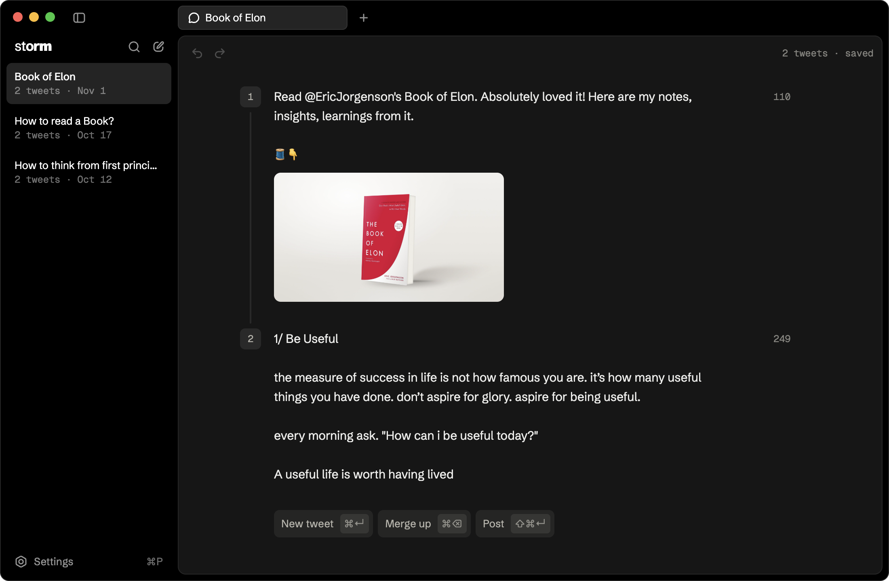

<p align="center">
  <picture>
    <source media="(prefers-color-scheme: dark)" srcset="assets/logo-dark.png" />
    
  </picture>
</p>

<p align="center">A quiet Mac app for writing tweet storms and keeping them.</p>

<p align="center"></p>

A storm is a list of tweets. You write them one after another, see at a glance which run past 280 characters, and post them to X a tweet at a time. Every storm is a plain Markdown file in your Documents folder, so nothing is locked inside the app.

## Run it

Storm needs [Node.js](https://nodejs.org) and a Mac.

```bash
npm install
```

```bash
npm start
```

To build the app itself (Apple Silicon):

```bash
npm run package
```

That writes `dist/Storm-darwin-arm64/Storm.app`, which you can move to Applications.

## Writing

- **Tweets.** `⌘↵` starts a new tweet at the cursor; `⌘⌫` merges a tweet into the one above. Each tweet shows its length and marks whatever runs over the limit.
- **Reordering.** Drag a tweet by its number. Drag tabs along the top bar.
- **Images.** Drop or paste up to four images onto a tweet. Drag them along their row to reorder them.
- **Tabs and the sidebar.** Storms open in tabs. The sidebar lists every storm, most recently edited first, and can be searched.
- **Undo.** Undo and redo cover the whole storm: typing, splits, merges, moves, deletions and images.
- **Appearance.** Six themes, each in light and dark, and an optional wallpaper behind a new storm.

## Posting

`⇧⌘↵` opens X in your browser with the first tweet already in the composer. Back in Storm, each press of Return copies the next piece (a tweet's words, then each of its images) for you to paste into X. Storm shows which tweets are done and which is next. `esc` stops.

Storm never posts for you and never signs in to X; it only hands over text and images.

## Shortcuts

| | |
| --- | --- |
| New storm | `⌘N` |
| New tab, close tab | `⌘T`, `⌘W` |
| Next tab, previous tab | `⌃⇥`, `⌃⇧⇥` |
| New tweet | `⌘↵` |
| Merge up | `⌘⌫` |
| Delete tweet | `⇧⌘⌫` |
| Post to X | `⇧⌘↵` |
| Undo, redo | `⌘Z`, `⇧⌘Z` |
| Find in storm | `⌘F` |
| Search storms | `⇧⌘F` |
| Toggle sidebar | `⌘B` |
| Settings | `⌘P` |

## Where storms live

Storms are kept in `~/Documents/Storms`, one Markdown file each. Tweets are separated by a line of three dashes, and an optional first line gives the storm its name:

```markdown
# On writing in public

The first tweet.

---

The second tweet.


```

A tweet's images sit in a folder beside the file, named after the storm. You can read, edit, sync or back up these files with anything.

Settings and open tabs are kept in `~/Library/Application Support/Storm`.

## Working on it

Storm is an Electron app with no build step:

- `main.js`: the window, the menu, files, clipboard and the hand-off to X
- `preload.js`: the small API the window is allowed to call
- `renderer/`: the interface (`index.html`, `style.css`, `app.js`), themes and the wallpaper effects

Set `STORM_DIR` to keep storms somewhere else while you work, so your own are left alone:

```bash
STORM_DIR=/tmp/storms npm start
```

## Credits

Set in [Schibsted Grotesk](https://github.com/schibsted/schibsted-grotesk) and [Geist Mono](https://vercel.com/font). The wallpaper's dither effect uses [Paper Shaders](https://github.com/paper-design/shaders). See [renderer/assets/CREDITS.md](renderer/assets/CREDITS.md) for the rest.
